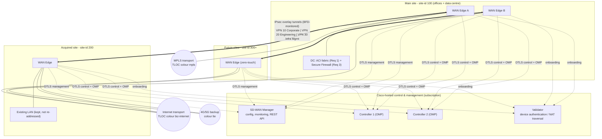
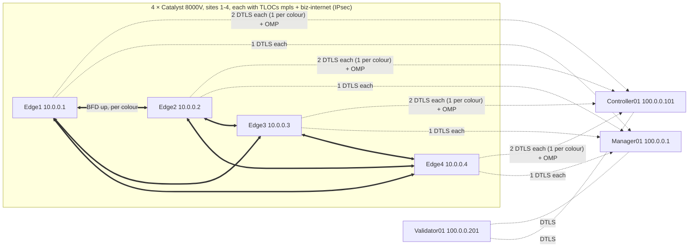
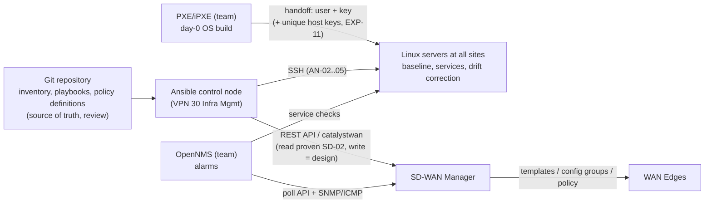

# Proposed Northstar WAN and management architecture (design - not deployed)

GitHub renders these diagrams; screenshot them for the report (or redraw in draw.io). Logical design only: the PoC evidence is the DevNet sandbox (SD-01/02) and the Ansible lab (AN-01..06).

## Figure A - Proposed Catalyst SD-WAN architecture for Northstar (SD-03)

Caption suggestion: *Figure N - Proposed logical SD-WAN design for Northstar: cloud-hosted control plane, dual-transport main site, acquired and future sites joining the same segmented IPsec overlay. Design only; the observed equivalent in the DevNet sandbox is described in SD-03.*

## Figure B - What was observed in the DevNet sandbox (SD-03 evidence)

Caption suggestion: *Figure N - Overlay state retrieved via the SD-WAN Manager API on 12 Nov 2026: 7 reachable devices, 12 IPsec tunnels (6 site pairs × 2 colours, all BFD up), single service VPN (VPN 1). Source: `evidence/api/20261112-224846_overlay_state.json`.*

## Figure C - Integration of Ansible and SD-WAN Manager (INT-01)

Caption suggestion: *Figure N - Division of responsibilities: Ansible configures servers directly and SD-WAN Manager through its API; edges are configured only by Manager. Solid = demonstrated in PoC (SSH to servers, read-only API); labelled "design" = not tested.*
